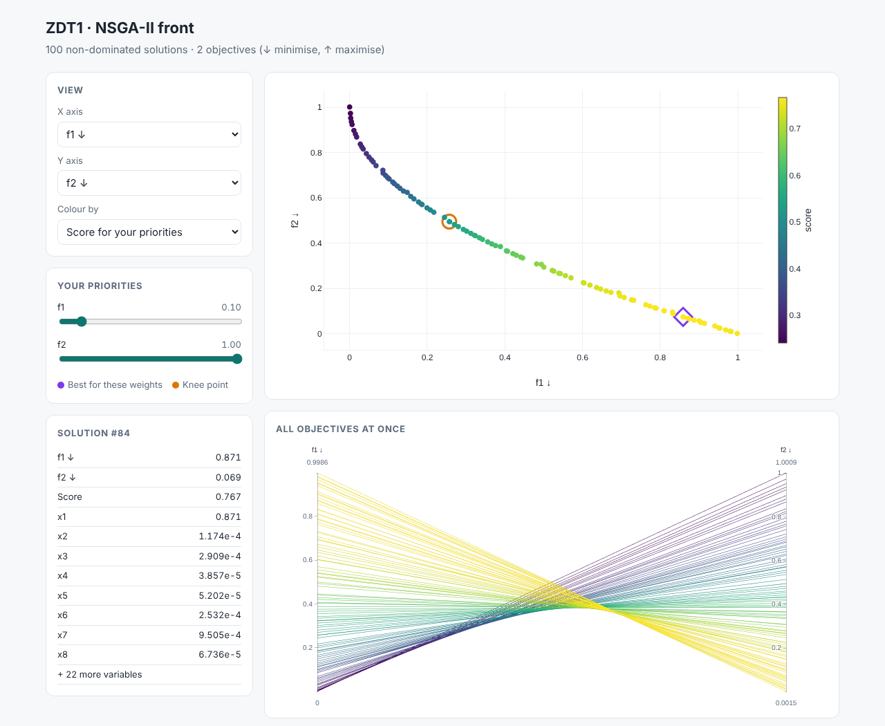

# paretolens

**Explore, compare and pick solutions from a multi-objective Pareto front.**

Optimisers like NSGA-II hand you back a cloud of trade-off solutions. The hard part comes next. You have to decide which one to recommend and explain why. `paretolens` turns that front into something you can reason with. It finds the knee point, ranks solutions for any set of priorities and writes an interactive HTML page you can share with colleagues who don't use Python.

[**▶ Live demo**](https://thashmikab.github.io/paretolens/) · works with [pymoo](https://pymoo.org), CSV files or any NumPy array



## Install

```bash
pip install git+https://github.com/Thashmikab/paretolens.git
# with pymoo for the examples
pip install "paretolens[pymoo] @ git+https://github.com/Thashmikab/paretolens.git"
```

## Use it in three lines

```python
from paretolens import Front

front = Front.from_csv("results.csv", objectives={"cost": "min", "co2": "min", "energy": "max"})
print(front.summary())                       # extremes, knee and best compromise
front.to_html("report.html")                 # interactive explorer
```

Straight from a pymoo run:

```python
res = minimize(problem, NSGA2(pop_size=100), ("n_gen", 200))
front = Front.from_pymoo(res, names=["cost", "co2"])
```

From the command line:

```bash
paretolens results.csv --min cost --min co2 --max energy -o report.html
```

## What it gives you

| | |
|---|---|
| `front.summary()` | The best solution for each objective, the knee point and the best compromise, all in real units |
| `front.knee()` | The solution where improving one objective starts costing a lot in the others |
| `front.topsis({"cost": 2, "co2": 1})` | A TOPSIS score for every solution under your own priorities |
| `front.best(weights)` | The top-ranked solution for those priorities |
| `front.pseudo_weights()` | How strongly each solution favours each objective |
| `front.tradeoff(i, j, "cost", "co2")` | How much CO₂ you change per unit of cost when moving from solution *i* to *j* |
| `front.nondominated()` | Drops dominated rows if you load a whole population |
| `front.hypervolume()` | Normalised hypervolume, for comparing runs (2 objectives) |
| `front.to_html(...)` | A single-file interactive report |

The HTML report lets you pick any two objectives to plot, colour by a third, and move priority sliders to watch the best solution change. It also shows every objective on parallel coordinates, and you can click any point to see its decision variables.

## How the numbers are worked out

Each objective is turned into "smaller is better" and scaled to 0–1 across the front, so 0 is the best value found.

- **Knee point.** This is the solution furthest towards the ideal from the plane f₁ + … + fₘ = 1 (Das, 1999; Deb & Gupta, 2011). A concave front has no real knee, so there it returns an extreme point.
- **TOPSIS.** This measures weighted distance to the ideal (all 0) and to the anti-ideal (all 1). The score is closeness to the ideal, from 0 to 1 (Hwang & Yoon, 1981).
- **Pseudo-weights.** These follow Deb (2001), *Multi-Objective Optimization using Evolutionary Algorithms*.

## Examples

- [`examples/zdt1_with_pymoo.py`](examples/zdt1_with_pymoo.py) runs NSGA-II on ZDT1 and builds a report.
- [`examples/dtlz2_three_objectives.py`](examples/dtlz2_three_objectives.py) shows three objectives with a mix of minimise and maximise.

## Why I built this

My PhD work optimises UK renewable energy roadmaps against several environmental impacts of critical materials at once. NSGA-II gives hundreds of valid roadmaps, and the real question from supervisors and industry was always "so which one should we pick?" This package is the toolkit I wanted for answering that.

## Licence

MIT. Built by [Thashmika Bandara](https://github.com/Thashmikab).
